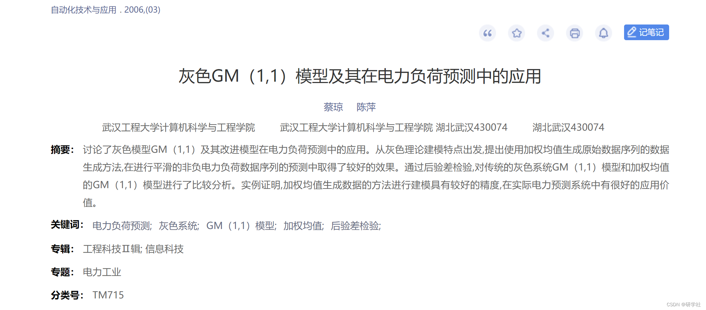
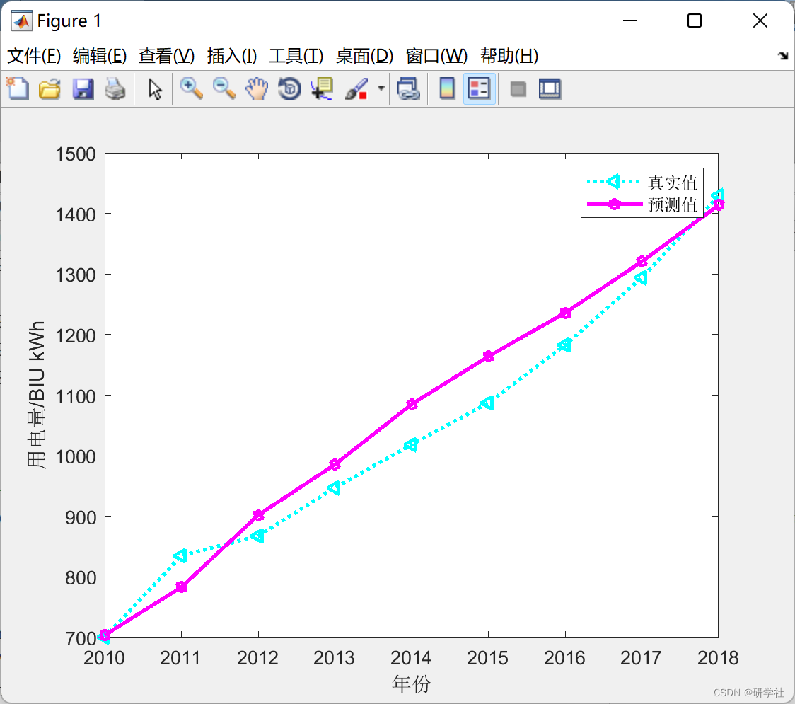

# Gray GM (1,1) Model and Its Application in Electric Power Load Forecasting (Matlab Code Implementation)

🏆 Bloggers' Advantage: 🌞🌞🌞 The content of the blog strives for rigorous thinking and clear logic to facilitate readers.
⛳️ Mantra: A journey of a thousand miles is half done in the last ninety minutes.
💥1 Overview📚
References:
Editor
In power systems, various data constitute an extremely vast information storage system. However, in actual operation, a large amount of useful data has not been fully exploited, yet these pieces of information hold important reference value during decision-making processes. Power load forecasting is a fundamental task in power systems, determining the rational arrangement of generation, transmission, distribution, etc. Accurate load forecasting can ensure the safe and stable operation of the power grid and effectively reduce power generation costs, improve economic benefits, and social benefits. Especially as further deepening of power reforms, the formation of the power market, and the autonomy and profit-and-loss responsibility of power enterprises, the work of power load forecasting has become increasingly important. Power load forecasting is a guarantee for the safe and economical operation of the power system and the realization of optimized dispatching of the power grid.
System theory is a practical prediction method in the business world. Grey system theory regards all random processes as changing within a certain range and related to time, organizing disordered original data into a regular generating sequence for further study. That is, by some kind of generation, weakening its randomness, displaying its regularity, and establishing models for grey processes are called grey models. Grey system theory has the advantages of requiring less sample data and not needing to calculate statistical characteristics. Grey prediction solves the problem of modeling continuous differential equations. It seeks the patterns of numbers through the organization of original data. In modeling, firstly, the original data is accumulated or decrementally generated to form a new sequence, and then establishes a differential equation model and analytical analysis on the new sequence to achieve the purpose of predicting the original sequence.
📚2 Running Results​Edit
🎉3 References  
🌈4 Matlab Code Implementation

## Images

<!-- PAYMENT_BLOCK -->

## Get this dataset

- Payment link (Stripe): [Buy now](https://buy.stripe.com/3cs8yP7sY87d0vu9AB)
- Payment QR code: 

<!-- /PAYMENT_BLOCK -->
